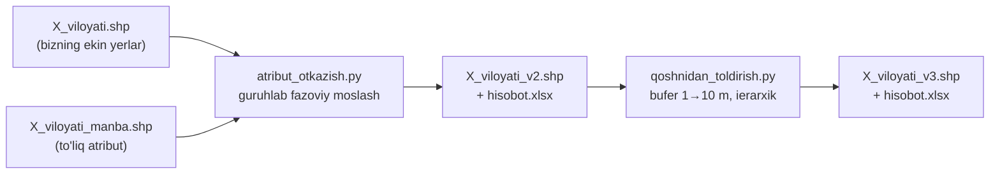
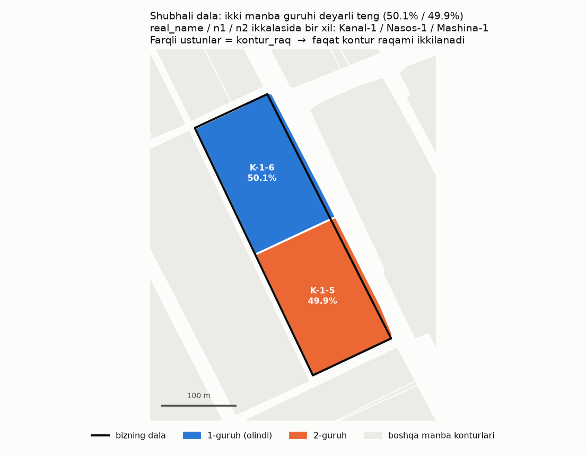

# viloyat_shp — ekin yerlariga nomenklatura va fermer ma'lumotini o'tkazish

Viloyat shp fayllari bilan ishlash (har bir viloyat alohida). Ikki skript bor:

| Skript | Nima qiladi |
|---|---|
| [`atribut_otkazish.py`](atribut_otkazish.py) | to'liq atributli **manba** shp dan bizning ekin yerlariga `kontur_raq`, `real_name`, `real_n1`, `real_n2` va fermer nomini fazoviy moslab o'tkazadi |
| [`qoshnidan_toldirish.py`](qoshnidan_toldirish.py) | manbaga tegmagani uchun **bo'sh qolgan** ekin yerlarini yonidagi to'lgan dalalardan to'ldiradi |

Ikkalasi ham kirish fayllarini o'zgartirmaydi (fayl xeshi bilan tekshiriladi), natijani yangi shp
ga va Excel hisobotga yozadi.

## O'rnatish

Conda (conda-forge) muhiti kerak — GDAL/PROJ bilan `geopandas`, `pyogrio`, `shapely>=2`, `openpyxl`:

```bash
conda env create -f environment.yml
```

`run.bat` avval `viloyat_shp` muhitini, bo'lmasa `fenologiya` muhitini ishlatadi (`conda activate`
shart emas). `muhit.py` conda ning `Library\bin`, `GDAL_DATA`, `PROJ_LIB` yo'llarini sozlaydi —
muhit faollashtirilmagan holda ham ishlashi uchun.

| Fayl | Vazifasi |
|---|---|
| `atribut_otkazish.py` | 1-qadam: manbadan o'tkazish |
| `qoshnidan_toldirish.py` | 2-qadam: qo'shnidan to'ldirish |
| `muhit.py` | conda yo'llarini sozlash (numpy dan oldin import qilinadi) |
| `run.bat` | Windows da ishga tushirish |
| `environment.yml` | conda muhiti |
| `rasmlar/` | README rasmlari |

## Ish tartibi



Har skriptda kirish/chiqish fayl boshidagi **FOYDALANUVCHI SOZLAMALARI** blokida qo'lda yoziladi.
Masalan, X viloyat uchun:

```python
# atribut_otkazish.py
KIRISH  = r"D:\malumot\X_viloyati.shp"         # bizning ekin yerlar
MANBA   = r"D:\malumot\X_viloyati_manba.shp"   # to'liq atributli manba
CHIQISH = r"D:\natija\X_viloyati_v2.shp"       # yangi fayl

# qoshnidan_toldirish.py
KIRISH  = r"D:\natija\X_viloyati_v2.shp"       # 1-qadam natijasi
CHIQISH = r"D:\natija\X_viloyati_v3.shp"       # yangi fayl
```

Keyin repo papkasidan ishga tushiriladi:

```bash
.\run.bat atribut_otkazish.py
.\run.bat qoshnidan_toldirish.py
```

---

## 1-qadam. `atribut_otkazish.py` — manbadan o'tkazish

### Sozlamalar

| O'zgaruvchi | Ma'nosi |
|---|---|
| `KIRISH` | ma'lumot qabul qiladigan viloyat shp (o'zgarmaydi) |
| `MANBA` | to'liq atributli shp (faqat o'qiladi, o'zgarmaydi) |
| `CHIQISH` | natija shp (yangi fayl) |
| `HISOBOT` | Excel hisobot; `None` — `CHIQISH` yonida `<nomi>_hisobot.xlsx` |
| `USTUNLAR` | `{manbadagi nomi: bizdagi nomi}`. Manbada nomlar bir xil bo'lsa `kontur_raq → kontur_raq`, …; boshqacha bo'lsa, masalan `ID → kontur_raq`, `LVL_0_name → real_name`, `LVL_1_name → real_n1`, `LVL_2_name → real_n2` |
| `FERMER_BIZDA` / `FERMER_MANBADA` | bizdagi bo'sh `full_name` manbadagi fermer nomidan to'ldiriladi |
| `MIN_ULUSH` | moslik chegarasi (standart 0.5) |
| `ULUSH_USTUNI` | moslik ulushi ustuni (`mos_ulush`), kerak bo'lmasa `None` |
| `USTIGA_YOZ` | natija bor bo'lsa ustiga yozilsinmi |

### Mos ekin yerga mos ma'lumot qanday o'tkaziladi

Ikki faylda umumiy kalit ustun yo'q, proyeksiyalari ham har xil bo'lishi mumkin (masalan
EPSG:3857 va UTM). Shuning uchun konturlar **joylashuvi bo'yicha** (fazoviy) moslanadi.

**Muammo:** bizdagi bitta dala manbada ko'pincha bir nechta kichik konturga bo'lingan, lekin
ularning nomenklaturasi bir xil — nomenklatura bitta dala ichida o'zgarmaydi. Eng katta bitta
manba konturini olsak, har bo'lak dalaning 50% idan kam bo'lib, dala bo'sh qolardi.


1. **Guruhlab moslash.** O'tkaziladigan qiymatlari bir xil manba konturlari bitta guruh. Har
   bizning dala uchun har guruhning birlashgan kesishmasi hisoblanadi va eng katta ulushli guruh
   olinadi. Bir-birini qoplagan manba konturlari ikki marta sanalmaydi.
   - **Nomenklatura** — `kontur_raq + real_name + real_n1 + real_n2` to'rttasi birga, bitta
     guruhdan olinadi: biri bir bo'lakdan, boshqasi boshqa bo'lakdan aralashib ketmaydi.
   - **Fermer nomi** — alohida, fermer nomi qiymati bo'yicha guruhlanadi (bitta nomenklatura
     ichida fermer har xil bo'lishi mumkin). Faqat bo'sh `full_name` to'ldiriladi, bor qiymat
     o'zgarmaydi.
2. **Xavfsizlik chegarasi.** Guruh kesishmasi dala maydonining kamida 50% i bo'lishi shart
   (`MIN_ULUSH = 0.5`). Kam bo'lsa — hech narsa o'tkazilmaydi, boshqa konturning ma'lumoti
   adashib tushmaydi.
3. **Teng nomzodlar.** Ikki guruh teng bo'lsa, natija har safar bir xil: manbadagi qator tartibi
   bo'yicha birinchisi olinadi.
4. **`mos_ulush` ustuni** — har dalaga nomenklatura guruhining ulushi (0–1). QGIS/ArcGIS da
   `mos_ulush < 0.9` ni filtrlab, chegaradagi dalalarni ko'rish mumkin.
5. **O'zgarmaslik tekshiruvi.** Skript boshida va oxirida MANBA va KIRISH fayllarining xeshini
   solishtiradi; natijaning geometriyasi, CRS i va kontur soni kirish bilan bir xilligini tekshiradi.

Guruhlab moslash avval to'lgan dalalarning birortasini ham o'zgartirmaydi — faqat "bo'laklarga
bo'lingan" dalalarni qo'shimcha to'ldiradi. Bitta viloyatda bo'sh qolganlar taxminan ikki
baravar kamaydi.

### Shubhali dala nimani bildiradi

Dala manbadagi ikki konturning o'rtasida yotsa va ikkala guruh ulushi deyarli teng bo'lsa
(2-guruh ≥ 90% × 1-guruh), skript kattasini oladi va dalani hisobotning **Shubhali** varag'iga
yozadi. **Farqli ustunlar** qaysi qiymat aniq emasligini ko'rsatadi:



- **faqat `kontur_raq`** — `real_name`, `real_n1`, `real_n2` ikkala guruhda bir xil, ular aniq;
  faqat qaysi kontur raqami yozilgani ikkilanadi. Odatda shubhalilarning ko'pchiligi shunday.
- **`kontur_raq` + `real_*`** — nomenklatura darajasi ham har xil: shularni xaritada ko'rib chiqing.

### Excel hisobot

| Varaq | Nima bor |
|---|---|
| **Umumiy** | fayllar; CRS lar (KIRISH, MANBA, moslash qaysi CRS da, CHIQISH); ekin yerlar soni va maydoni (ga) — KIRISH va CHIQISH da; ma'lumot o'tgan / bo'sh qolganlar soni va maydoni; shubhalilar farqli ustunlar bo'yicha; tekshiruv |
| **Ustunlar** | qaysi ustundan qaysi ustunga: avval bo'sh edi, to'ldirildi, bo'sh qoldi, avvaldan bor (o'zgarmadi), foizlar |
| **Moslik** | moslik ulushi oraliqlari (≥ 0.99, 0.90–0.99, …, kesishma yo'q) bo'yicha konturlar soni; nechtasi bir nechta bo'lakdan yig'ilgan |
| **Tumanlar** | har tuman: kontur soni va maydoni, mos topilgan / bo'sh qolgan, `full_name` to'ldirilishi |
| **Bo'sh qolganlar** | ma'lumot o'tmagan dalalar (FID, unique_id, tuman, maydon, sabab) |
| **Shubhali** | deyarli teng ikki guruhli dalalar: farqli ustunlar, olingan va 2-guruh qiymatlari yonma-yon |

Misol uchun X viloyat hisobotining "Umumiy" varag'ida shunday qatorlar bo'ladi: *Ekin yerlar
soni — KIRISH: N*, *Ekin yerlar maydoni — KIRISH: Y ga*, *Ma'lumot o'tgan ekin yerlar: N₁
(Y₁ ga)*, *Bo'sh qolgan: N₂ (Y₂ ga)* — CHIQISH dagi soni va maydoni KIRISH bilan bir xil bo'lishi shart.

---

## 2-qadam. `qoshnidan_toldirish.py` — qo'shnidan to'ldirish

Manbaga tegmagan yoki 50% ga yetmagan (ya'ni `real_name`, `real_n1`, `real_n2`, `kontur_raq`
**hammasi bo'sh**) dalalarga yonidagi to'lgan dalalardan qiymat beradi. Manbadan to'lgan dalalar
o'zgarmaydi.

### Sozlamalar

| O'zgaruvchi | Ma'nosi |
|---|---|
| `KIRISH` | 1-qadam natijasi (`X_viloyati_v2.shp`), o'zgarmaydi |
| `CHIQISH` | natija shp (yangi fayl) |
| `HISOBOT` | Excel hisobot; `None` — `CHIQISH` yonida `<nomi>_hisobot.xlsx` |
| `USTUNLAR` | to'ldiriladigan ustunlar, **yirikdan maydaga**: `real_name, real_n1, real_n2, kontur_raq` |
| `KELISHUV` | ierarxik to'ldirish chegarasi (standart 0.67) |
| `QADAM_M` / `MAX_M` | bufer qadami va eng katta masofa (1 m / 10 m) |
| `TEKSHIRUV_SONI` | sinov uchun nechta dala (5000; 0 — sinov yo'q) |
| `USTIGA_YOZ` | natija bor bo'lsa ustiga yozilsinmi |

### Bufer qoidasi


1. Bo'sh dalaga 1 m bufer beriladi. To'lgan dalaga tegsa — shu qadamda to'xtaydi; tegmasa 2 m,
   3 m, … 10 m gacha oshiriladi. Faqat birinchi tekkan qadamdagi qo'shnilar "ovoz beradi".
2. Bitta qo'shni tegsa — uning qiymatlari olinadi; bir nechta tegsa — eng ko'p takrorlangani.
   Teng bo'lsa — bufer ichida maydoni kattasi, keyin eng yaqini.
3. **Zanjir yo'q:** faqat avvaldan to'lgan dalalar qo'shni bo'ladi — yangi to'ldirilgan dala
   boshqasiga manba bo'lmaydi, xato tarqalmaydi.
4. **Haqiqiy metr:** hisob UTM da. KIRISH EPSG:3857 da bo'lsa ham — 3857 da "1 m" haqiqatda
   1 m dan kichik (kenglikka qarab, O'zbekistonda taxminan 0.75–0.8 m).

### Ierarxik to'ldirish

Qo'shnilar har xil bo'lsa, hamma ustunni ko'pchilikdan olish xavfli (sinovda bunday holatlarning
taxminan yarmi to'g'ri chiqdi). Shuning uchun har daraja alohida tekshiriladi:
`real_name → real_n1 → real_n2 → kontur_raq`. Qo'shnilar **`KELISHUV` ulushida** kelishgan eng
chuqur darajagacha yoziladi, undan maydaroq ustunlar bo'sh qoladi.


`KELISHUV = 0.67` — daraja qiymati qo'shnilarning kamida 0.67 qismida bo'lishi shart:
3 qo'shnidan 2 tasi (0.667) **yetmaydi**, 4 tadan 3 tasi (0.75) yetadi. `1.0` — hamma qo'shni
kelishsin; `0` — ierarxiyasiz (doim to'liq, eng ko'p takrorlangani).

### Natijadagi yangi ustunlar

| Ustun | Ma'nosi |
|---|---|
| `toldi_usul` | `manba` — 1-qadamdan; `qoshni` — qo'shnidan to'liq; `qoshni_qisman` — faqat yirik darajalar; `kelishmadi` — qo'shnilar `real_name` da ham kelishmadi; `bosh` — 10 m ichida qo'shni yo'q |
| `toldi_dar` | nechta ustun to'ldi (0–4): 1 = `real_name`, 2 = `+real_n1`, 3 = `+real_n2`, 4 = hammasi |
| `qoshni_m` | qo'shni necha metrlik buferda topildi (1–10) |
| `qoshni_n` | shu buferga tekkan to'lgan qo'shnilar soni |
| `qoshni_ul` | yozilgan eng chuqur daraja qiymati qo'shnilarning qancha qismida (0–1) |

### Sinov: qanchalik ishonish mumkin

To'lgan, lekin **chetdagi** dalalar (yonida 10 m ichida bo'sh dala bor) bo'sh deb faraz qilinadi,
shu qoida bilan qiymat topiladi va haqiqiysi bilan solishtiriladi. Natija hisobotning **Sinov** va
**Qadamlar** varaqlarida — har viloyat uchun alohida. Bitta viloyat namunasi:


`KELISHUV` ni tanlash (o'sha namunada):

| `KELISHUV` | Hammasi to'g'ri | Qo'shnilari har xil dalalarda | Ulardan to'g'ri |
|---|---|---|---|
| 0 (ierarxiyasiz) | ~94% | hammasi to'liq yoziladi | ~51% |
| **0.67 (standart)** | **~95%** | ko'pi qisman, bir qismi bo'sh qoladi | **100%** |
| 1.0 | ~95% | qisman yoki bo'sh | 100% |

### Excel hisobot

| Varaq | Nima bor |
|---|---|
| **Umumiy** | fayllar, CRS, qoida; avval to'lgan / avval bo'sh / to'liq / qisman (necha ustun) / bo'sh qoldi (soni va maydoni); sinov aniqligi; tekshiruv |
| **Qadamlar** | har bufer (1–10 m): qo'shni topildi, to'liq, qisman, kelishmadi, maydoni, sinovda to'g'ri % |
| **Tumanlar** | har tuman: avval bo'sh, to'liq, qisman, bo'sh qoldi (soni va maydoni) |
| **To'ldirilganlar** | har dala: `toldi_usul`, to'ldirilgan ustunlar, bufer, masofa, qo'shnilar soni, bir xil / har xil, yozilgan qiymat va ulushi, to'liq eng ko'pi va 2-nomzod |
| **Bo'sh qolganlar** | sababi bilan: 10 m ichida qo'shni yo'q yoki qo'shnilar kelishmadi |
| **Sinov** | aniqlik bufer bo'yicha va qo'shnilar bir xil / har xil bo'yicha, har ustun alohida |

### Natijani qanday o'qish kerak (X viloyat misoli)

| `toldi_usul` | Ma'nosi |
|---|---|
| `manba` | 1-qadamda manbadan to'lgan — o'zgarmaydi |
| `qoshni` | N₁ ta dala: qo'shnidan 4 ustun to'liq yozildi |
| `qoshni_qisman` | N₂ ta dala: faqat kelishilgan yirik darajalar yozildi |
| `kelishmadi` | N₃ ta dala: qo'shnilar `real_name` da ham kelishmadi — bo'sh |
| `bosh` | N₄ ta dala: 10 m ichida to'lgan qo'shni yo'q — bo'sh |

Bo'sh dalalarning ikkala turi ham olinadi: manbaga umuman tegmaganlar va manbaga tekkan-u 50%
ga yetmaganlar. Odatda bo'sh dalalarning yarmiga yaqini qo'shnidan to'ladi; qolganlari to'lgan
dalalardan ancha uzoqda (o'nlab metr) bo'ladi.

### Ishchilar uchun: nimani avval ko'rib chiqish kerak

1. `toldi_usul = kelishmadi` va `qoshni_qisman` — qo'shnilar kelishmagan joylar.
2. `qoshni_m >= 8` — uzoqdan topilgan (sinovda ~81–86% to'g'ri).
3. `toldi_usul = bosh` — qo'lda to'ldirish kerak (yaqinida to'lgan dala yo'q).

---

## Eslatmalar

- 10 m dan oshirish tavsiya qilinmaydi: aniqlik 9–10 m da ~80–84% ga tushadi, qolgan bo'sh
  dalalar esa odatda ancha uzoqda.
- 1-qadam hisobotidagi "Geometriya maydoni" manba EPSG:3857 da bo'lsa 3857 birligida
  hisoblanadi va oshib chiqadi; moslash natijasiga ta'sir qilmaydi (ulushlar nisbiy), haqiqiy
  maydon uchun `maydon` ustuniga qarang.
- Rasmlar haqiqiy dalalardan olingan, lekin viloyat, tuman, kontur kodlari va nomlar shartli
  (X viloyat, Y tuman, K-1, Kanal-1 …).
