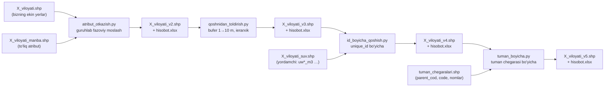
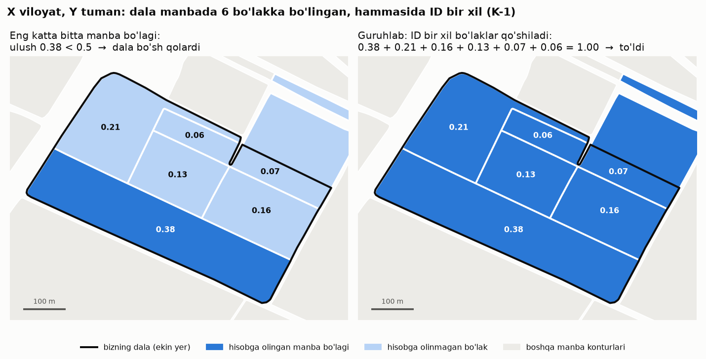
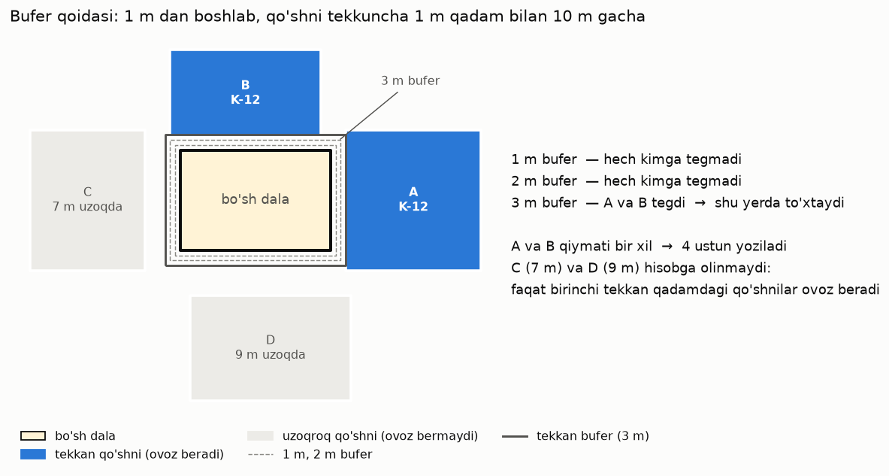
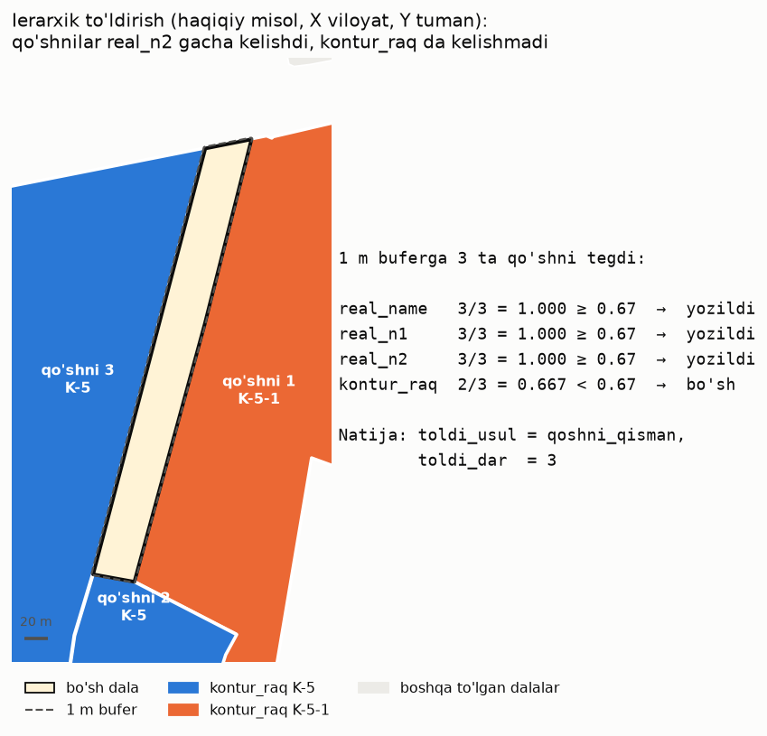
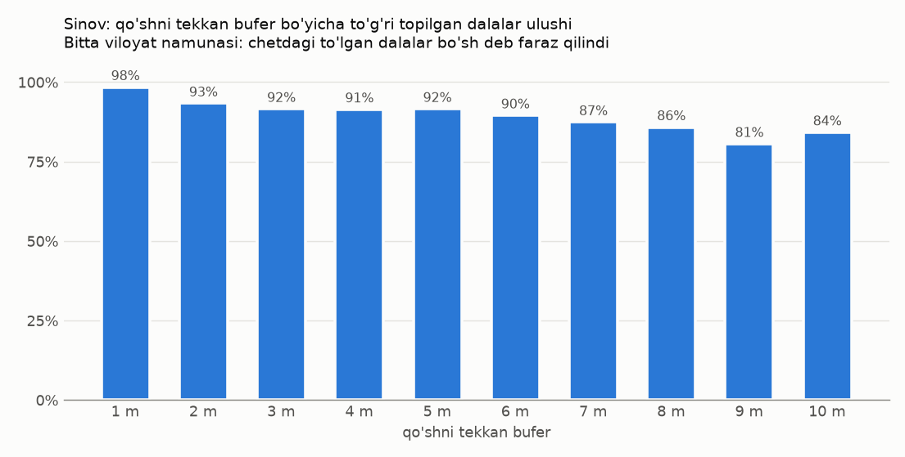

# viloyat_shp — ekin yerlariga nomenklatura va fermer ma'lumotini o'tkazish

Viloyat shp fayllari bilan ishlash (har bir viloyat alohida). Beshta skript bor:

| Skript | Nima qiladi |
|---|---|
| [`atribut_otkazish.py`](atribut_otkazish.py) | to'liq atributli **manba** shp dan bizning ekin yerlariga `kontur_raq`, `real_name`, `real_n1`, `real_n2` va fermer nomini fazoviy moslab o'tkazadi |
| [`qoshnidan_toldirish.py`](qoshnidan_toldirish.py) | manbaga tegmagani uchun **bo'sh qolgan** ekin yerlarini yonidagi to'lgan dalalardan to'ldiradi |
| [`id_boyicha_qoshish.py`](id_boyicha_qoshish.py) | boshqa (yordamchi) fayldan **unique_id bo'yicha** kerakli ustunlarni qo'shadi (masalan `uw3_m3 … uw10_m3`, `uwt_m3`) |
| [`tuman_boyicha.py`](tuman_boyicha.py) | **tuman chegaralari** bo'yicha har bir dalaga viloyat va tuman kodini beradi (`parent_cod → region_id`, `code → distrct_id`) va nomlarni tekshiradi |
| [`kadastr_birlashtirish.py`](kadastr_birlashtirish.py) | ikki **kadastr** faylini (yangi, lekin to'liq emas + eski, lekin to'liqroq) bitta to'liq kadastr fayliga birlashtiradi: kadastr raqami, egasi, INN, JShShIR |

Hammasi kirish fayllarini o'zgartirmaydi (fayl xeshi bilan tekshiriladi), natijani yangi shp ga va
Excel hisobotga yozadi.

## O'rnatish

Conda (conda-forge) muhiti kerak — GDAL/PROJ bilan `geopandas`, `pyogrio`, `shapely>=2`, `openpyxl`:

```bash
conda env create -f environment.yml
```

`run.bat` avval `viloyat_shp` muhitini, bo'lmasa `fenologiya` muhitini ishlatadi (`conda activate`
shart emas). Yoki muhitni faollashtirib, to'g'ridan-to'g'ri: `python kadastr_birlashtirish.py`.

> **Har bir skript mustaqil.** Bitta `.py` faylning o'zini boshqa kompyuterga ko'chirsangiz ham
> ishlaydi — boshqa skriptlar ham, `muhit.py` ham kerak emas: yordamchi funksiyalar va conda yo'llarini
> sozlash (`Library\bin`, `GDAL_DATA`, `PROJ_LIB`) har bir faylning o'zida. Kerak bo'lgani faqat
> Python paketlari (`environment.yml`) va fayl boshidagi sozlamalarda shu kompyuterdagi yo'llar.

| Fayl | Vazifasi |
|---|---|
| `atribut_otkazish.py` | 1-qadam: manbadan o'tkazish |
| `qoshnidan_toldirish.py` | 2-qadam: qo'shnidan to'ldirish |
| `id_boyicha_qoshish.py` | 3-qadam: ID bo'yicha ustun qo'shish |
| `tuman_boyicha.py` | 4-qadam: tuman chegarasi bo'yicha viloyat / tuman kodi |
| `kadastr_birlashtirish.py` | kadastr: ikki kadastr faylini birlashtirish (ekin yerlarga bog'lashdan oldin) |
| `muhit.py` | conda yo'llarini sozlash (alohida modul sifatida; skriptlar unga bog'liq emas — xuddi shu kod har bir skriptning ichida) |
| `run.bat` | Windows da ishga tushirish |
| `environment.yml` | conda muhiti |
| `rasmlar/` | README rasmlari |

## Ish tartibi



Qadamlar mustaqil: kerakli qadamni o'tkazib yuborish yoki boshqa tartibda ishlatish mumkin —
faqat `KIRISH` / `ASL` ga oldingi natijani bering.

Har skriptda kirish/chiqish fayl boshidagi **FOYDALANUVCHI SOZLAMALARI** blokida qo'lda yoziladi.
Masalan, X viloyat uchun:

```python
# atribut_otkazish.py
KIRISH  = r"D:\malumot\X_viloyati.shp"         # bizning ekin yerlar
MANBA   = r"D:\malumot\X_viloyati_manba.shp"   # to'liq atributli manba
CHIQISH = r"D:\natija\X_viloyati_v2.shp"       # yangi fayl

# qoshnidan_toldirish.py
KIRISH  = r"D:\natija\X_viloyati_v2.shp"       # 1-qadam natijasi
CHIQISH = r"D:\natija\X_viloyati_v3.shp"       # yangi fayl

# id_boyicha_qoshish.py
ASL       = r"D:\natija\X_viloyati_v3.shp"     # 2-qadam natijasi
YORDAMCHI = r"D:\malumot\X_viloyati_suv.shp"   # ustunlar olinadigan fayl
CHIQISH   = r"D:\natija\X_viloyati_v4.shp"     # yangi fayl

# tuman_boyicha.py
ASL     = r"D:\natija\X_viloyati_v4.shp"       # 3-qadam natijasi
CHEGARA = r"D:\malumot\tuman_chegaralari.shp"  # tuman chegaralari
CHIQISH = r"D:\natija\X_viloyati_v5.shp"       # yangi fayl
```

Keyin repo papkasidan ishga tushiriladi:

```bash
.\run.bat atribut_otkazish.py
.\run.bat qoshnidan_toldirish.py
.\run.bat id_boyicha_qoshish.py
.\run.bat tuman_boyicha.py
```

---

## 1-qadam. `atribut_otkazish.py` — manbadan o'tkazish

### Sozlamalar

| O'zgaruvchi | Ma'nosi |
|---|---|
| `KIRISH` | ma'lumot qabul qiladigan viloyat shp (o'zgarmaydi) |
| `MANBA` | to'liq atributli shp (faqat o'qiladi, o'zgarmaydi) |
| `CHIQISH` | natija shp (yangi fayl) |
| `HISOBOT` | Excel hisobot; `None` — `CHIQISH` yonida `<nomi>_hisobot.xlsx` |
| `USTUNLAR` | `{manbadagi nomi: bizdagi nomi}`. Manbada nomlar bir xil bo'lsa `kontur_raq → kontur_raq`, …; boshqacha bo'lsa, masalan `ID → kontur_raq`, `LVL_0_name → real_name`, `LVL_1_name → real_n1`, `LVL_2_name → real_n2` |
| `FERMER_BIZDA` / `FERMER_MANBADA` | bizdagi bo'sh `full_name` manbadagi fermer nomidan to'ldiriladi |
| `MIN_ULUSH` | moslik chegarasi (standart 0.5) |
| `ULUSH_USTUNI` | moslik ulushi ustuni (`mos_ulush`), kerak bo'lmasa `None` |
| `USTIGA_YOZ` | natija bor bo'lsa ustiga yozilsinmi |

### Mos ekin yerga mos ma'lumot qanday o'tkaziladi

Ikki faylda umumiy kalit ustun yo'q, proyeksiyalari ham har xil bo'lishi mumkin (masalan
EPSG:3857 va UTM). Shuning uchun konturlar **joylashuvi bo'yicha** (fazoviy) moslanadi.

**Muammo:** bizdagi bitta dala manbada ko'pincha bir nechta kichik konturga bo'lingan, lekin
ularning nomenklaturasi bir xil — nomenklatura bitta dala ichida o'zgarmaydi. Eng katta bitta
manba konturini olsak, har bo'lak dalaning 50% idan kam bo'lib, dala bo'sh qolardi.



1. **Guruhlab moslash.** O'tkaziladigan qiymatlari bir xil manba konturlari bitta guruh. Har
   bizning dala uchun har guruhning birlashgan kesishmasi hisoblanadi va eng katta ulushli guruh
   olinadi. Bir-birini qoplagan manba konturlari ikki marta sanalmaydi.
   - **Nomenklatura** — `kontur_raq + real_name + real_n1 + real_n2` to'rttasi birga, bitta
     guruhdan olinadi: biri bir bo'lakdan, boshqasi boshqa bo'lakdan aralashib ketmaydi.
   - **Fermer nomi** — alohida, fermer nomi qiymati bo'yicha guruhlanadi (bitta nomenklatura
     ichida fermer har xil bo'lishi mumkin). Faqat bo'sh `full_name` to'ldiriladi, bor qiymat
     o'zgarmaydi.
2. **Xavfsizlik chegarasi.** Guruh kesishmasi dala maydonining kamida 50% i bo'lishi shart
   (`MIN_ULUSH = 0.5`). Kam bo'lsa — hech narsa o'tkazilmaydi, boshqa konturning ma'lumoti
   adashib tushmaydi.
3. **Teng nomzodlar.** Ikki guruh teng bo'lsa, natija har safar bir xil: manbadagi qator tartibi
   bo'yicha birinchisi olinadi.
4. **`mos_ulush` ustuni** — har dalaga nomenklatura guruhining ulushi (0–1). QGIS/ArcGIS da
   `mos_ulush < 0.9` ni filtrlab, chegaradagi dalalarni ko'rish mumkin.
5. **O'zgarmaslik tekshiruvi.** Skript boshida va oxirida MANBA va KIRISH fayllarining xeshini
   solishtiradi; natijaning geometriyasi, CRS i va kontur soni kirish bilan bir xilligini tekshiradi.

Guruhlab moslash avval to'lgan dalalarning birortasini ham o'zgartirmaydi — faqat "bo'laklarga
bo'lingan" dalalarni qo'shimcha to'ldiradi. Bitta viloyatda bo'sh qolganlar taxminan ikki
baravar kamaydi.

### Shubhali dala nimani bildiradi

Dala manbadagi ikki konturning o'rtasida yotsa va ikkala guruh ulushi deyarli teng bo'lsa
(2-guruh ≥ 90% × 1-guruh), skript kattasini oladi va dalani hisobotning **Shubhali** varag'iga
yozadi. **Farqli ustunlar** qaysi qiymat aniq emasligini ko'rsatadi:


- **faqat `kontur_raq`** — `real_name`, `real_n1`, `real_n2` ikkala guruhda bir xil, ular aniq;
  faqat qaysi kontur raqami yozilgani ikkilanadi. Odatda shubhalilarning ko'pchiligi shunday.
- **`kontur_raq` + `real_*`** — nomenklatura darajasi ham har xil: shularni xaritada ko'rib chiqing.

### Excel hisobot

| Varaq | Nima bor |
|---|---|
| **Umumiy** | fayllar; CRS lar (KIRISH, MANBA, moslash qaysi CRS da, CHIQISH); ekin yerlar soni va maydoni (ga) — KIRISH va CHIQISH da; ma'lumot o'tgan / bo'sh qolganlar soni va maydoni; shubhalilar farqli ustunlar bo'yicha; tekshiruv |
| **Ustunlar** | qaysi ustundan qaysi ustunga: avval bo'sh edi, to'ldirildi, bo'sh qoldi, avvaldan bor (o'zgarmadi), foizlar |
| **Moslik** | moslik ulushi oraliqlari (≥ 0.99, 0.90–0.99, …, kesishma yo'q) bo'yicha konturlar soni; nechtasi bir nechta bo'lakdan yig'ilgan |
| **Tumanlar** | har tuman: kontur soni va maydoni, mos topilgan / bo'sh qolgan, `full_name` to'ldirilishi |
| **Bo'sh qolganlar** | ma'lumot o'tmagan dalalar (FID, unique_id, tuman, maydon, sabab) |
| **Shubhali** | deyarli teng ikki guruhli dalalar: farqli ustunlar, olingan va 2-guruh qiymatlari yonma-yon |

Misol uchun X viloyat hisobotining "Umumiy" varag'ida shunday qatorlar bo'ladi: *Ekin yerlar
soni — KIRISH: N*, *Ekin yerlar maydoni — KIRISH: Y ga*, *Ma'lumot o'tgan ekin yerlar: N₁
(Y₁ ga)*, *Bo'sh qolgan: N₂ (Y₂ ga)* — CHIQISH dagi soni va maydoni KIRISH bilan bir xil bo'lishi shart.

---

## 2-qadam. `qoshnidan_toldirish.py` — qo'shnidan to'ldirish

Manbaga tegmagan yoki 50% ga yetmagan (ya'ni `real_name`, `real_n1`, `real_n2`, `kontur_raq`
**hammasi bo'sh**) dalalarga yonidagi to'lgan dalalardan qiymat beradi. Manbadan to'lgan dalalar
o'zgarmaydi.

### Sozlamalar

| O'zgaruvchi | Ma'nosi |
|---|---|
| `KIRISH` | 1-qadam natijasi (`X_viloyati_v2.shp`), o'zgarmaydi |
| `CHIQISH` | natija shp (yangi fayl) |
| `HISOBOT` | Excel hisobot; `None` — `CHIQISH` yonida `<nomi>_hisobot.xlsx` |
| `USTUNLAR` | to'ldiriladigan ustunlar, **yirikdan maydaga**: `real_name, real_n1, real_n2, kontur_raq` |
| `KELISHUV` | ierarxik to'ldirish chegarasi (standart 0.67) |
| `QADAM_M` / `MAX_M` | bufer qadami va eng katta masofa (1 m / 10 m) |
| `TEKSHIRUV_SONI` | sinov uchun nechta dala (5000; 0 — sinov yo'q) |
| `USTIGA_YOZ` | natija bor bo'lsa ustiga yozilsinmi |

### Bufer qoidasi



1. Bo'sh dalaga 1 m bufer beriladi. To'lgan dalaga tegsa — shu qadamda to'xtaydi; tegmasa 2 m,
   3 m, … 10 m gacha oshiriladi. Faqat birinchi tekkan qadamdagi qo'shnilar "ovoz beradi".
2. Bitta qo'shni tegsa — uning qiymatlari olinadi; bir nechta tegsa — eng ko'p takrorlangani.
   Teng bo'lsa — bufer ichida maydoni kattasi, keyin eng yaqini.
3. **Zanjir yo'q:** faqat avvaldan to'lgan dalalar qo'shni bo'ladi — yangi to'ldirilgan dala
   boshqasiga manba bo'lmaydi, xato tarqalmaydi.
4. **Haqiqiy metr:** hisob UTM da. KIRISH EPSG:3857 da bo'lsa ham — 3857 da "1 m" haqiqatda
   1 m dan kichik (kenglikka qarab, O'zbekistonda taxminan 0.75–0.8 m).

### Ierarxik to'ldirish

Qo'shnilar har xil bo'lsa, hamma ustunni ko'pchilikdan olish xavfli (sinovda bunday holatlarning
taxminan yarmi to'g'ri chiqdi). Shuning uchun har daraja alohida tekshiriladi:
`real_name → real_n1 → real_n2 → kontur_raq`. Qo'shnilar **`KELISHUV` ulushida** kelishgan eng
chuqur darajagacha yoziladi, undan maydaroq ustunlar bo'sh qoladi.



`KELISHUV = 0.67` — daraja qiymati qo'shnilarning kamida 0.67 qismida bo'lishi shart:
3 qo'shnidan 2 tasi (0.667) **yetmaydi**, 4 tadan 3 tasi (0.75) yetadi. `1.0` — hamma qo'shni
kelishsin; `0` — ierarxiyasiz (doim to'liq, eng ko'p takrorlangani).

### Natijadagi yangi ustunlar

| Ustun | Ma'nosi |
|---|---|
| `toldi_usul` | `manba` — 1-qadamdan; `qoshni` — qo'shnidan to'liq; `qoshni_qisman` — faqat yirik darajalar; `kelishmadi` — qo'shnilar `real_name` da ham kelishmadi; `bosh` — 10 m ichida qo'shni yo'q |
| `toldi_dar` | nechta ustun to'ldi (0–4): 1 = `real_name`, 2 = `+real_n1`, 3 = `+real_n2`, 4 = hammasi |
| `qoshni_m` | qo'shni necha metrlik buferda topildi (1–10) |
| `qoshni_n` | shu buferga tekkan to'lgan qo'shnilar soni |
| `qoshni_ul` | yozilgan eng chuqur daraja qiymati qo'shnilarning qancha qismida (0–1) |

### Sinov: qanchalik ishonish mumkin

To'lgan, lekin **chetdagi** dalalar (yonida 10 m ichida bo'sh dala bor) bo'sh deb faraz qilinadi,
shu qoida bilan qiymat topiladi va haqiqiysi bilan solishtiriladi. Natija hisobotning **Sinov** va
**Qadamlar** varaqlarida — har viloyat uchun alohida. Bitta viloyat namunasi:



`KELISHUV` ni tanlash (o'sha namunada):

| `KELISHUV` | Hammasi to'g'ri | Qo'shnilari har xil dalalarda | Ulardan to'g'ri |
|---|---|---|---|
| 0 (ierarxiyasiz) | ~94% | hammasi to'liq yoziladi | ~51% |
| **0.67 (standart)** | **~95%** | ko'pi qisman, bir qismi bo'sh qoladi | **100%** |
| 1.0 | ~95% | qisman yoki bo'sh | 100% |

### Excel hisobot

| Varaq | Nima bor |
|---|---|
| **Umumiy** | fayllar, CRS, qoida; avval to'lgan / avval bo'sh / to'liq / qisman (necha ustun) / bo'sh qoldi (soni va maydoni); sinov aniqligi; tekshiruv |
| **Qadamlar** | har bufer (1–10 m): qo'shni topildi, to'liq, qisman, kelishmadi, maydoni, sinovda to'g'ri % |
| **Tumanlar** | har tuman: avval bo'sh, to'liq, qisman, bo'sh qoldi (soni va maydoni) |
| **To'ldirilganlar** | har dala: `toldi_usul`, to'ldirilgan ustunlar, bufer, masofa, qo'shnilar soni, bir xil / har xil, yozilgan qiymat va ulushi, to'liq eng ko'pi va 2-nomzod |
| **Bo'sh qolganlar** | sababi bilan: 10 m ichida qo'shni yo'q yoki qo'shnilar kelishmadi |
| **Sinov** | aniqlik bufer bo'yicha va qo'shnilar bir xil / har xil bo'yicha, har ustun alohida |

### Natijani qanday o'qish kerak (X viloyat misoli)

| `toldi_usul` | Ma'nosi |
|---|---|
| `manba` | 1-qadamda manbadan to'lgan — o'zgarmaydi |
| `qoshni` | N₁ ta dala: qo'shnidan 4 ustun to'liq yozildi |
| `qoshni_qisman` | N₂ ta dala: faqat kelishilgan yirik darajalar yozildi |
| `kelishmadi` | N₃ ta dala: qo'shnilar `real_name` da ham kelishmadi — bo'sh |
| `bosh` | N₄ ta dala: 10 m ichida to'lgan qo'shni yo'q — bo'sh |

Bo'sh dalalarning ikkala turi ham olinadi: manbaga umuman tegmaganlar va manbaga tekkan-u 50%
ga yetmaganlar. Odatda bo'sh dalalarning yarmiga yaqini qo'shnidan to'ladi; qolganlari to'lgan
dalalardan ancha uzoqda (o'nlab metr) bo'ladi.

### Ishchilar uchun: nimani avval ko'rib chiqish kerak

1. `toldi_usul = kelishmadi` va `qoshni_qisman` — qo'shnilar kelishmagan joylar.
2. `qoshni_m >= 8` — uzoqdan topilgan (sinovda ~81–86% to'g'ri).
3. `toldi_usul = bosh` — qo'lda to'ldirish kerak (yaqinida to'lgan dala yo'q).

---

## 3-qadam. `id_boyicha_qoshish.py` — ID bo'yicha ustun qo'shish

Bizning faylga (odatda 2-qadam natijasi) boshqa fayldan kerakli ustunlarni **unique_id bo'yicha**
olib keladi. Masalan suv hajmi ustunlari `uw3_m3 … uw10_m3`, `uwt_m3` yoki fermer nomi va INN
alohida faylda turadi. Ustun ASL da bo'lmasa — yangi ustun qo'shiladi; bor, lekin to'liq bo'lmasa —
**faqat bo'sh kataklari to'ldiriladi**. Bu yerda fazoviy moslash yo'q — faqat ID mosligi.

### Sozlamalar

| O'zgaruvchi | Ma'nosi |
|---|---|
| `ASL` | ma'lumot qabul qiladigan shp (o'zgarmaydi) |
| `YORDAMCHI` | ustunlar olinadigan fayl: shp, gpkg, dbf, csv yoki xlsx (faqat o'qiladi) |
| `CHIQISH` | natija shp (yangi fayl) |
| `HISOBOT` | Excel hisobot; `None` — `CHIQISH` yonida `<nomi>_hisobot.xlsx` |
| `ID_ASL` / `ID_YORDAMCHI` | ID ustuni nomi har bir faylda (har xil bo'lishi mumkin, masalan `unique_id` va `uniqueid`) |
| `ID_TOZALASH` | IDlarni solishtirishdan oldin tozalash: kichik harf; bo'sh joy, `-`, `{`, `}` olib tashlanadi |
| `USTUNLAR` | `{yordamchidagi nomi: natijadagi nomi}` — kerakli ustunlar, nomini o'zgartirish ham mumkin (shp: 10 belgigacha) |
| `BOR_USTUN` | natijadagi nom ASL da bor bo'lsa: `"toldir"` — faqat bo'sh kataklar (standart), `"almashtir"` — yordamchida qiymat bor joyda almashtirish, `"xato"` — to'xtash |
| `BIRGA` | birga to'ldiriladigan ustunlar guruhi, masalan `[["full_name", "tax_number"]]` |
| `NOM_SOLISHTIRISH` | guruhda nomlarni solishtirish: `"yumshoq"` (standart) yoki `"qattiq"` |
| `XLSX_VARAQ` / `CSV_AJRATUVCHI` | yordamchi xlsx yoki csv bo'lsa |
| `USTIGA_YOZ` | natija bor bo'lsa ustiga yozilsinmi |

Masalan, suv hajmi (yangi ustunlar):

```python
ID_ASL = "unique_id"
ID_YORDAMCHI = "uniqueid"
USTUNLAR = {
    "uw3_m3": "uw3_m3",
    # ...
    "uwt_m3": "uwt_m3",
}
```

Fermer ma'lumoti (ASL dagi to'liq bo'lmagan `full_name`, `tax_number` ni to'ldirish):

```python
USTUNLAR = {
    "farmer_nam": "full_name",
    "farmer_inn": "tax_number",
}
BOR_USTUN = "toldir"
BIRGA = [["full_name", "tax_number"]]
```

### Qoida

1. **ID tozalash.** `ID_TOZALASH = True` bo'lsa, `5E474CF4-C7CE-…` va `5e474cf4c7ce…` bir xil
   hisoblanadi. Fayllardagi IDlar o'zgarmaydi — faqat solishtirish uchun.
2. **Bog'lash.** ASL dagi har qatorga yordamchida shu ID li qatorning qiymatlari yoziladi. ID
   topilmasa — yangi ustunlar bo'sh qoladi. ASL ning qatorlari, ustunlari va geometriyasi o'zgarmaydi.
3. **Takrorlar.** Yordamchida bir ID bir necha marta uchrasa — birinchi qatori olinadi. Qiymatlari
   farqli takrorlar hisobotning **Takrorlar** varag'ida ko'rsatiladi.
4. **ASL da bor ustun** (`BOR_USTUN = "toldir"`). Faqat ASL dagi **bo'sh kataklar** yordamchidan
   to'ldiriladi; bor qiymat o'zgarmaydi (yordamchida boshqacha bo'lsa ham — hisobotda sanaladi).
   Qiymat ASL ustuni turiga keltiriladi: matn ustunga `308337301.0` emas, `308337301` yoziladi.
   Yangi nom bilan alohida ustun kerak bo'lsa — `USTUNLAR` da boshqa nom bering (masalan
   `"yield": "yield_2"`).
5. **Birga to'ldirish** (`BIRGA`). Fermer nomi va INN bitta fermerga tegishli. Bo'sh `tax_number`
   faqat ASL dagi `full_name` bo'sh yoki yordamchidagi nom bilan **bir fermer** bo'lsa to'ldiriladi —
   aks holda bir fermer nomi yoniga boshqa fermer INN i tushib qolardi. Bunday qatorlar
   hisobotning **Guruh mos emas** varag'ida.

   `NOM_SOLISHTIRISH = "yumshoq"` da quyidagilar bir fermer hisoblanadi:

   | ASL | Yordamchi | Nimasi farq qiladi |
   |---|---|---|
   | `"A AGRO" MCHJ` | `"A AGRO" MAS'ULIYATI CHEKLANGAN JAMIYAT` | yuridik shakl |
   | `"B" FX` | `ФЕРМЕРСКОЕ ХОЗЯЙСТВО "B"` | yuridik shakl, til |
   | `"C D" FX` | `C D ФЕРМЕР ХУЖАЛИГИ` (kirillda) | kirill / lotin |
   | `"E F O'G'LI" FX` | `ФХ "E F O`G`L` (kesilgan) | apostrof, kesilgan nom |

   `Y tumani hokimiyati` ↔ `"Z" FX` — boshqa fermer, INN yozilmaydi.
6. **Tekshiruv.** ASL va YORDAMCHI fayllari xeshi o'zgarmagan (fayl boshqa dasturda, masalan ArcGIS
   da tahrir qilinayotgan bo'lsa — skript buni aytadi); natijada qator soni, geometriya va CRS bir xil;
   ASL dagi bor qiymatlar o'zgarmagan.

### Excel hisobot

| Varaq | Nima bor |
|---|---|
| **Umumiy** | fayllar, ID ustunlari; ASL: qatorlar (va maydoni), noyob ID, bo'sh ID; YORDAMCHI: qatorlar, noyob ID, bo'sh ID, takrorlar; **ID orqali o'tdi** (noyob ID va qator, maydoni), **o'tmadi**, yordamchida ortiqcha IDlar; tekshiruv |
| **Ustunlar** | har ustun: yangi yoki ASL da bor; avval bo'sh edi, to'ldirildi, bo'sh qoldi, avvaldan bor (o'zgarmadi), bor qiymat yordamchidan farqli, guruh mos emas, to'ldi % |
| **Tumanlar** | har tuman: qatorlar, ID orqali o'tdi, o'tmadi, %; har to'ldirilgan ustun bo'yicha nechta katak |
| **Guruh mos emas** | `BIRGA` sharti bajarilmagan qatorlar: `unique_id`, tuman, ASL dagi va yordamchidagi nom / INN yonma-yon |
| **O'tmaganlar** | ID topilmagan qatorlar (FID, ID, tuman, maydon, sabab) |
| **Ortiqcha IDlar** | yordamchida bor, ASL da yo'q IDlar |
| **Takrorlar** | yordamchida qiymatlari farqli takror IDlar |

X viloyat uchun "Umumiy" varag'i shunday o'qiladi: *ASL da N ta noyob ID*, *YORDAMCHI da M ta
noyob ID*, *ID orqali o'tdi: N₁ (Y₁ ga)*, *o'tmadi: N₂ (Y₂ ga)*, *yordamchida ortiqcha: M₁*.

> Agar "o'tdi" 0 bo'lsa — ikki faylning ID tizimi boshqa (masalan yordamchi o'z IDlarini
> ishlatadi). Bunda ID ustunini to'g'ri tanlang yoki IDlari mos fayldan foydalaning.

---

## 4-qadam. `tuman_boyicha.py` — tuman chegarasi bo'yicha kodlar

Tuman chegaralari faylidan har bir dalaga viloyat va tuman kodini beradi: tuman ichidagi dala o'sha
tumanning atributlarini oladi.

### Sozlamalar

| O'zgaruvchi | Ma'nosi |
|---|---|
| `ASL` | ekin yerlar shp (o'zgarmaydi) |
| `CHEGARA` | tuman chegaralari shp (faqat o'qiladi) |
| `CHIQISH` | natija shp (yangi fayl) |
| `HISOBOT` | Excel hisobot; `None` — `CHIQISH` yonida `<nomi>_hisobot.xlsx` |
| `USTUNLAR` | `{chegaradagi nomi: natijadagi nomi}`: `parent_cod → region_id`, `code → distrct_id` |
| `NOM_TEKSHIRUV` | `{ASL dagi ustun: chegaradagi ustun}`: `viloyat ↔ region_nam`, `tuman ↔ district` |
| `NOMLARNI_YANGILASH` | `True` — natijada `viloyat` / `tuman` chegaradagi rasmiy nomlar bilan almashadi (standart `False`) |
| `ULUSH_USTUNI` | dala tumanga qancha qismi bilan tushgani (0–1) ustuni; kerak bo'lmasa `None` |
| `SHUBHA_ULUSH` | dala tumanga shundan kam qismi bilan tushsa — shubhali (standart 0.9) |
| `ID_USTUNI` | hisobot ro'yxatlarida ko'rsatiladigan ID (`unique_id`) |
| `USTIGA_YOZ` | natija bor bo'lsa ustiga yozilsinmi |

> Shapefile ustun nomi 10 belgigacha: `district_id` (11) yozilmaydi, shuning uchun `distrct_id`.

### Qoida

1. **Fazoviy.** Dala eng ko'p maydon bilan qaysi tuman ichida yotsa, o'sha tumanning kodlari olinadi
   (hisob UTM da, metrda). Ikki tuman chegarasidagi dala — kattaroq qismi qaysi tumanda bo'lsa.
   Chegara faylidagi noto'g'ri (invalid) geometriyalar hisob uchun tuzatiladi, fayl o'zgarmaydi.
2. **Nom tekshiruvi.** `viloyat` / `tuman` nomlari chegaradagi `region_nam` / `district` bilan
   solishtiriladi. Apostrof turi (`'` va `‘`), katta-kichik harf va "shahar / shahri",
   "tuman / tumani" farqi hisobga olinmaydi:

   | Holat | Misol |
   |---|---|
   | **mos** | `Y tumani` ↔ `Y tumani`; `Z shahar` ↔ `Z shahri` |
   | **qo'shimchasiz mos** | `Z` ↔ `Z shahri` — faqat bittasida "tumani / shahri" yo'q |
   | **farqli** | `Z tumani` ↔ `Z shahri` (ikki xil hudud) yoki boshqa tuman nomi |

   Kodlar baribir fazoviy beriladi — nom tekshiruvi faqat xabar beradi. Farqli dalalar odatda tuman
   chegarasidan o'tib ketgan kichik dalalar yoki ASL dagi eski nomlar.
3. **Shubhali dalalar** — quyidagilardan kamida bittasi bo'lsa:
   - dala tumanga `SHUBHA_ULUSH` (0.9) dan kam qismi bilan tushgan — qolgani boshqa tumanda;
   - tuman (yoki viloyat) nomi **farqli** yoki ASL da bo'sh;
   - dala hech qaysi tumanga tegmagan.

   "Qo'shimchasiz mos" (`Z` ↔ `Z shahri`) shubhali hisoblanmaydi.
4. **Tekshiruv.** ASL va CHEGARA fayllari xeshi o'zgarmagan; natijada dala soni, geometriya, CRS va
   ASL ustunlari bir xil.

### Excel hisobot

| Varaq | Nima bor |
|---|---|
| **Umumiy** | fayllar, CRS; shp da nechta dala (soni, maydoni); tumanga tushdi / 2+ tuman chegarasida / hech qaysi tumanga tegmadi; **shubhali dalalar** soni va sabablari; nom tekshiruvi (mos, qo'shimchasiz mos, farqli); tekshiruv |
| **Tumanlar** | qaysi tumanga nechta dala tushdi: viloyat va tuman (chegara), `region_id`, `distrct_id`, dalalar soni, maydoni, ASL da qanday nom bilan yozilgani, chegaradagi va shubhali dalalar; oxirida JAMI |
| **Shubhali** | har shubhali dala alohida qator: `unique_id`, ASL dagi `viloyat` / `tuman`, chegara bo'yicha viloyat / tuman, kodlar, shu tumandagi ulush, 2-tuman va ulushi, `maydon`, `crop`, **sabab** |
| **Nom farqlari** | ASL dagi nom ↔ chegaradagi nom juftliklari, holati, dalalar soni va maydoni |
| **Chegaradagi dalalar** | 2+ tumanga tegadigan dalalar: olingan tuman va ulushi, 2-tuman va ulushi |
| **Tegmaganlar** | hech qaysi tuman ichida bo'lmagan dalalar (bo'lsa) |

---

## Kadastr. `kadastr_birlashtirish.py` — ikki kadastr faylini birlashtirish

Yerning kimga tegishliligi (egasi, INN, JShShIR, kadastr raqami) — suv va soliq hisobi uchun asosiy
ma'lumot. Odatda ikki fayl bo'ladi:

- **A** — yangi uzkad: egalar ma'lumoti to'liq (jismoniy shaxsda familiya, ism, otasining ismi
  alohida ustunlarda; INN — yuridik shaxs va fermer xo'jaligida, JShShIR — jismoniy shaxsda), lekin
  ba'zi parsellar yo'q;
- **B** — eski fayl: parsellar ko'proq, lekin eski; faqat kadastr raqami va to'liq nom.

### Sozlamalar

| O'zgaruvchi | Ma'nosi |
|---|---|
| `A_FAYL` / `B_FAYL` | ikki kadastr shp (faqat o'qiladi) |
| `CHIQISH` / `HISOBOT` | natija shp va Excel hisobot |
| `A_*` / `B_*` | ustun nomlari: kadastr raqami, egasi (familiya / ism / otasining ismi), INN, JShShIR, tuman, yer fondi … |
| `JISMONIY` | jismoniy shaxs turi (shu bilan boshlansa — F.I.Sh birlashtiriladi) |
| `B_QOPLANISH` | B parsel qo'shiladi, agar A poligonlari uni shundan kam qoplasa (standart 0.1) |
| `JSHSHIR_YOZ` | JShShIR natijaga yozilsinmi |

### Qoida

1. **Asos — A**: hamma parsellari va hamma ustunlari saqlanadi. Ustiga yagona ustunlar qo'shiladi:
   `kad_raqam`, `eski_kad`, `egasi` (jismoniy shaxsda familiya + ism + otasining ismi), `egasi_turi`,
   `inn`, `jshshir`, `viloyat`, `tuman`, `tuman_kod`, `yer_fondi`, `huquq`, `mulk_turi`, `maydon_ga`.
2. A da geometriyasi yo'q parsel — geometriya B dan (kadastr raqami bir xil). A da egasi bo'sh — B dan.
3. **B dan faqat A da umuman yo'q parsellar qo'shiladi** (A poligonlari 10% dan kam qoplasa).
   A bilan qoplangan B parsellari (qayta ro'yxatdan o'tgan, bo'lingan, raqami o'zgargan) qo'shilmaydi —
   bir yer ikki egaga yozilmasligi uchun; ular hisobotda "eski B raqam → yangi A raqam" bo'lib turadi.
   Qisman qoplanganlar — "Ko'rib chiqish" ro'yxatida.
4. **B dan qo'shilganlarga INN / JShShIR:** shu tumanda xuddi shu ega A da bitta INN / JShShIR bilan
   uchrasa (nom yumshoq solishtiriladi) — o'sha olinadi, `inn_manba = "nom (A)"`.
5. Buzuq geometriyalar tuzatiladi; takror kadastr raqamlari `takror = 1`; raqami A da eski raqam
   (`OLDCADNUM`) bo'lgan B parseli `tekshir` ustunida belgilanadi.

### Natijadagi qo'shimcha ustunlar

| Ustun | Ma'nosi |
|---|---|
| `manba` | `A`, `A, geometriya B`, `A, egasi B`, `B (eski)` |
| `inn_manba` | `A` yoki `nom (A)` (B dan qo'shilganda nom bo'yicha topilgan) |
| `b_egasi` / `ega_ozgar` | B dagi egasi; kadastr raqami bir xil-u egasi boshqa bo'lsa `ha` (yangi egaga o'tgan) |
| `takror` | kadastr raqami takrorlanadi |
| `tekshir` | ko'rib chiqish kerak bo'lgan sabab |

### Excel hisobot

| Varaq | Nima bor |
|---|---|
| **Umumiy** | kirish (A, B, umumiy / faqat A / faqat B), natija (manbalar, egasi / INN / JShShIR bor), tekshiruv |
| **Tumanlar**, **Ega turlari**, **Manbalar** | soni, maydoni, INN / JShShIR bor, egasi o'zgargan |
| **Qayta ro'yxat** | A bilan qoplangan B parsellari: eski B raqam → yangi A raqam(lar) |
| **Ko'rib chiqish** | qisman qoplangan B parsellari |
| **B dan qo'shildi** | A da yo'q, B dan qo'shilgan parsellar, topilgan INN / JShShIR |
| **Egasi farqli** | kadastr raqami bir xil, egasi A va B da boshqa |
| **Takrorlar** | takror kadastr raqamlari |

> Natijada shaxsiy ma'lumot (JShShIR, F.I.Sh) bor — faylni faqat ichki ishda ishlating.

---

## Eslatmalar

- 10 m dan oshirish tavsiya qilinmaydi: aniqlik 9–10 m da ~80–84% ga tushadi, qolgan bo'sh
  dalalar esa odatda ancha uzoqda.
- 1-qadam hisobotidagi "Geometriya maydoni" manba EPSG:3857 da bo'lsa 3857 birligida
  hisoblanadi va oshib chiqadi; moslash natijasiga ta'sir qilmaydi (ulushlar nisbiy), haqiqiy
  maydon uchun `maydon` ustuniga qarang.
- Rasmlar haqiqiy dalalardan olingan, lekin viloyat, tuman, kontur kodlari va nomlar shartli
  (X viloyat, Y tuman, K-1, Kanal-1 …).
